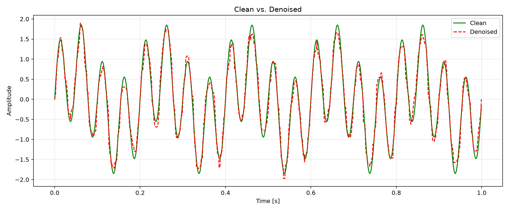

# Signal Denoising with Median Filtering

[](python/median_filter_signal_denoising.py)
[](#method)

> A reproducible Python experiment that reduces Gaussian noise in a composite time-domain signal using median filtering.



## What it demonstrates

- Generates a composite 5 Hz and 20 Hz sinusoidal signal.
- Adds deterministic Gaussian noise for reproducible experiments.
- Applies an odd-length median-filter window to reduce noise.
- Produces four plots and evaluates the result with Mean Squared Error (MSE).

## Method

```text
Clean composite signal -> Gaussian noise -> Median filter -> MSE evaluation
```

The default experiment uses a 1 kHz sampling rate, seed `42`, and an 11-sample window.

## Run

```bash
python -m venv .venv
.venv\\Scripts\\activate
pip install -r requirements.txt
python python/median_filter_signal_denoising.py --save-dir outputs
```

The validated default run reports an MSE of approximately `0.021386` and writes plots to `outputs/`.

## Context

Academic Digital Signal Processing laboratory project by Yahya Al Afifi, Islamic University of Gaza.

